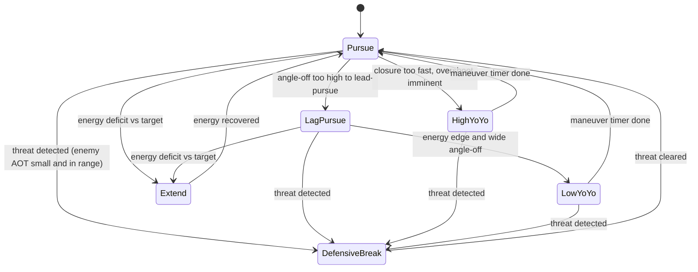

# AI Dogfight Strategy Overhaul

> **Status: implemented.** This document is the design plan for the ENGAGE-phase
> dogfight sub-state-machine added to `AiPilot`. All to-dos below were completed;
> the code lives in [src/script/ai/aiPilot.ts](../src/script/ai/aiPilot.ts) and
> [src/script/ai/dogfightGeometry.ts](../src/script/ai/dogfightGeometry.ts), with
> tests in `src/script/ai/dogfightGeometry.test.ts` and
> `src/script/ai/aiPilot.dogfight.test.ts`. Kept here as the rationale/reference
> for the design.

Give the AI opponent real basic-fighter-maneuver (BFM) decision-making — energy
management, defensive break turns, yo-yos, and disengage-to-extend — instead of
always flying straight lead-pursuit, by adding a maneuver sub-state-machine
inside the existing `ENGAGE` phase of `AiPilot`.

## Assumption (no answer given to clarifying questions)

Since the scope-narrowing questions were skipped, this plan targets a
**genuinely skilled, fair dogfighter** — it adds real tactics (energy
management, defensive maneuvers, yo-yos) tuned aggressively enough to win most
fights, while leaving a `skill` knob so it can be dialed down/up later without
another redesign. If a different intent was meant (e.g. a scripted "unbeatable
boss"), the design can be adjusted before further tuning.

## Current behavior (why the AI lost before this change)

All combat logic used to live in one method, `doEngage()`:

```ts
private doEngage(delta: number): void {
    ...
    // Gun lead solution: where the target will be when a bullet arrives.
    const tof = range / this.bulletSpeed;
    this.aim.copy(this.tvel).multiplyScalar(tof).add(this.tpos);
    ...
    this.commandHeading(desiredHeading, MAX_BANK_COMBAT);
    this.commandElevation(desiredElev);

    // Energy management: ease off when very close to avoid overshoot.
    const desiredSpeed = range < 250 ? this.combatSpeed * 0.7 : this.combatSpeed;
    this.commandSpeed(desiredSpeed, delta);

    this.firing = range <= this.gunRange && aimAngle <= GUN_CONE_RAD;
}
```

It always pointed the nose straight at the lead-pursuit aimpoint, regardless of
turn geometry, closure rate, or energy state, and it **never checked whether it
was itself being tracked/shot at** — so it never broke, never extended to
rebuild energy, and never used vertical maneuvers. This was the single method
replaced.

## New design: a maneuver sub-state-machine inside ENGAGE



### 1. Pure, testable geometry helpers — `src/script/ai/dogfightGeometry.ts`

Functions with no engine/state dependency, taking plain `THREE.Vector3`/numbers,
so they can be unit tested directly (previously there were **zero** AI tests):

- `specificEnergyHeight(altitude, speed)` — "energy height" `h + v²/(2g)`, used
  to compare the AI's total energy against the target's.
- `closureRate(myPos, myVel, targetPos, targetVel)` — signed range-rate along
  the line of sight (negative = closing).
- `trackingAngle(shooterPos, shooterForward, targetPos)` — angle between a
  shooter's nose and the line to a point; reused both for the AI's own gun
  solution (already computed inline before this change) and, with the
  **target's velocity as a nose proxy**, for detecting whether the target has a
  gun solution on the AI (its `Combatant` interface exposes only
  position/velocity, so velocity direction is used as the forward proxy —
  consistent with how the existing lead-pursuit math already treats target
  velocity as "the way it's pointed").
- `aspectAngle(observerPos, targetPos, targetVel)` — angle off the target's
  tail, used to classify offense/defense/neutral merges.
- `angleOff(myVel, targetVel)` — angle between the two flight paths, used to
  decide whether a lead-pursuit turn is flyable.

Covered by `src/script/ai/dogfightGeometry.test.ts` against known
hand-computed geometries (dead six, head-on, perpendicular, energy-advantage
cases).

### 2. Maneuver modes and transition logic — `src/script/ai/aiPilot.ts`

A `DogfightMode` enum (`PURSUE`, `LAG_PURSUE`, `HIGH_YOYO`, `LOW_YOYO`,
`DEFENSIVE_BREAK`, `EXTEND`) plus mode-timer/hysteresis state fields, following
the file's existing pattern for the terrain pull-up latch (`pullUpActive`).

`doEngage()` is now a thin dispatcher:

1. Compute shared per-frame geometry once (range, closure, angle-off, target's
   tracking angle on the AI, energy delta) via the geometry helpers.
2. `updateDogfightMode(...)` — the decision layer — evaluates transitions in
   priority order:
   - **Defensive break** (highest priority): target's `trackingAngle` on the
     AI is small AND range is inside a threat radius, sustained past a short
     reaction-delay timer (skill-dependent) → hard break turn toward the
     attacker's bearing at max bank, **does not fire**.
   - **Extend**: AI's energy height is meaningfully below the target's (and
     not already defensive) → heads away from the target, unloads, holds max
     throttle, accepts pointing off the target briefly to rebuild airspeed;
     exits back to `PURSUE` once energy height recovers past a threshold (and
     a minimum duration has elapsed, to avoid flip-flopping).
   - **High yo-yo**: closure rate high relative to range (overshoot imminent)
     → pulls the nose above the flight path briefly to bleed excess closure
     without losing energy, then resumes pursuit.
   - **Low yo-yo**: AI has an energy edge but angle-off is too large to
     out-turn the target directly → trades some altitude for turn
     rate/closure across the circle.
   - **Lag pursuit**: angle-off is too large for a lead-pursuit aimpoint to be
     flyable at the current bank/turn-rate limits → aims at a blended point
     between the target's current position and the lead point (previously the
     code always aimed at the pure lead point even when that required an
     impossible turn, a large source of overshoot/energy loss).
   - **Pursuit** (default/fallback): the original lead-pursuit logic, kept for
     the common, easily-flyable case.
3. Each mode has a small handler (`doPursue`, `doLagPursue`, `doHighYoYo`,
   `doLowYoYo`, `doDefensiveBreak`, `doExtend`) that sets heading/elevation/
   speed setpoints through the **existing** inner controllers
   (`commandHeading`, `commandElevation`, `commandSpeed` — unchanged) so all
   the PIO/overspeed/terrain safety guards already in the file keep applying.
4. The firing gate is suppressed whenever the active mode isn't nose-tracking
   the target (`EXTEND`, `HIGH_YOYO`, `LOW_YOYO`, `DEFENSIVE_BREAK`) even if
   the instantaneous aim angle happens to fall inside the cone.

New tuning constants live near the existing gain block, documented in the same
style, e.g. `DEFENSIVE_AOT_THRESHOLD`, `DEFENSIVE_RANGE_MULT`,
`YOYO_CLOSURE_TRIGGER`, `EXTEND_ENERGY_DEFICIT` (via `SkillTuning`),
`EXTEND_RECOVER_MARGIN`.

### 3. Difficulty/skill knob

`AiPilotOptions.skill?: AiSkillLevel` (`ROOKIE` / `VETERAN` / `ACE`, default
`ACE`), scaling:

- Defensive reaction delay — rookies notice threats slower.
- How readily the AI chooses `EXTEND` vs. staying in a losing turning fight
  (energy-deficit threshold).
- Firing discipline (gun-cone tolerance).

This is the first difficulty concept in the codebase, giving a single place to
tune "how hard is this to beat" later.

### 4. Wiring

`spawnOpponent()`'s call site in
[src/script/state/game.ts](../src/script/state/game.ts) passes
`skill: AiSkillLevel.ACE` in the opponent's `AiPilotOptions` literal; no other
call sites needed to change since `AiPilotOptions` fields stay optional with
backward-compatible defaults.

### 5. Tests

- `src/script/ai/dogfightGeometry.test.ts` — pure function unit tests per
  helper above.
- `src/script/ai/aiPilot.dogfight.test.ts` — scenario tests driving
  `AiPilot.update()` over many frames against lightweight fake
  `PilotableAircraft`/`WorldQuery`/`Combatant` implementations (no rendering or
  physics worker needed, using the existing `PilotableAircraft` boundary):
  - Starting on the target's six at good aspect and range → stays in a
    tracking mode and eventually fires.
  - Target maneuvers onto the AI's six within threat range → AI enters
    `DEFENSIVE_BREAK` within the reaction delay and does not fire while
    defensive.
  - AI energy height well below target's → AI enters `EXTEND` and holds it for
    at least its minimum duration rather than immediately turning back in.
  - A wide-angle-off crossing merge selects `LAG_PURSUE` instead of forcing an
    unflyable lead turn.

## Out of scope for this pass

- Multi-aircraft/wingman coordination (only one AI opponent exists today).
- Missiles (none exist in `src/`; combat is guns-only via
  [src/script/weapons/gun.ts](../src/script/weapons/gun.ts)).
- Changing the `Combatant` interface (no new fields needed; velocity is used
  as the forward-direction proxy for threat detection).

## Merge bench (2026-10-31)

The design above was only ever tested against scripted stand-ins (a kinematic
fake aircraft, a frozen target). Flown on the real flight model it did not
work, so there is now a bench that flies two AI pilots through a merge,
headless, on FM2:

- `src/script/physics/sim/dogfightMerge.ts`: `runMerge(setup, blue, red)` puts
  two `CombatSim` aircraft (default airframe, the game's gun and opponent
  options) on a merge, each targeting the other, and scores the fight: kills,
  crashes, midairs, hits, seconds offensive (in the other's rear 60 deg cone
  inside 2 km) and nose-on, minimum speed and altitude, time per maneuver
  label. `MERGE_SETUPS` holds twelve merges: the game's own (3 km head-on,
  co-altitude, 200 m/s), offset, stacked, mismatched-speed, beam, low, high,
  oblique and tail chase.
- `tools/dogfight_merge.ts` flies every pairing of pilot models through every
  merge from both sides and prints a table. `--blue/--red/--setup/--trace 1`
  fly one fight with a trace. A frozen copy of the classic pilot at
  `src/script/ai/aiPilotBaseline.ts` (untracked; copy `aiPilot.ts` there
  before changing it) joins the matrix as `BASE`, so a change fights what it
  replaces. The sim is deterministic in practice: gun spread is seeded and
  too small to change a hit.
- `src/script/physics/sim/dogfightMerge.test.ts` pins the classic pilot's
  results: no midair at the merge, no stall in a turning fight, kills against
  Shaw and Ace from the game's merge, no losses against the other models.

### What the bench found

Baseline, all four models, 96 fights of 180 s: **no kill at all**. Every
fight was a draw: twelve ended in head-on midairs, the rest with both
aircraft below 90 m/s for 40-120 s. Nobody fired a round outside the first
pass, even after 50-100 s sat behind the other inside 2 km.

Measured on the airframe: lift runs out at 18-20 deg AoA long before the
9.5 g limit, so full stick gives 2.3 g at 120 m/s, 4.1 g at 180 and 6.3 g at
240, and the jet still accelerates in that turn on full power. Turn rate
therefore rises with speed and the radius barely changes; there is no corner
speed below the 240 m/s overspeed cap. In the classic pilot:

1. **Speed.** It fought at a "corner speed" of 180 m/s, slowed to 0.65 x
   combat speed (117 m/s) inside 250 m, and cut to idle at the merge.
2. **The vertical.** The hard turn rolled only toward the aim's compass
   bearing and pulled. Where the aim was in the vertical played no part, so
   chasing a climbing target it pulled the nose up whatever the aim said, and
   both aircraft hung at 10 m/s.
3. **Tracking.** The hard turn switched in at 8 deg off the lead and out at 5,
   over heading/pitch loops tuned for navigation. The nose hunted 3-9 deg off
   the lead (30-90 m predicted miss against a 13 m allowance) and never fired.
4. **The merge.** Two lead-pursuing pilots flew straight down each other's
   noses into a midair.

### What changed (classic pilot only)

- `CORNER_SPEED` 180 -> 230 m/s; tucked in behind and closing it matches the
  target's speed plus 15 m/s, never below 160 (`combatTurnSpeed`).
- Hard turns put the lift vector on the aim, allowing for the 1 g that holds
  the aircraft up, roll before they pull when the lift is more than 90 deg
  off, use full stick, and may pull inverted above 1200 m AGL over the deck.
- Pursuit tracks with one law (`commandTrack`): commanded lift = line-of-sight
  rate x speed + `TRACK_GAIN` (6/s) x speed x aim error + 1 g, stick sized
  from the measured stick-to-g curve, and a small push rather than a roll
  through 180 deg. Gains of 4, 6 and 8 all won the same share; 6 resolved
  more fights.
- Below 170 m/s the steepest climb pursuit will aim at falls to 15 deg nose
  low at 110 m/s (`capAimClimb`).
- If the straight-line paths would pass within 150 m in the next 4 s, the aim
  is pushed aside to pass clear, left to left when dead on (`deconflictAim`).

Result, same matrix plus `BASE`: the classic pilot wins 84 of 96 fights
against Shaw, Aggressive and Ace and 19 of 24 against its old self, loses
none, and never crashes or collides. Against itself 5 of 24 fights end in a
kill. Shaw, Aggressive and Ace still never shoot anything down (and still
collide at the merge): they fly their own tactical layers and controllers
and have none of these fixes.

### Shaw, Aggressive and Ace (2026-10-31)

All three fly their tactical FSM's setpoints through the one shared
`FlightControlComputer` (`src/script/ai/shaw/flightControlComputer.ts`), so
most of the fix went there:

- **Controller.** The heading/elevation cascade (75 deg bank cap, 50 deg
  climb cap) and the compass-bearing hard turn are gone; every setpoint is
  flown with the classic `commandTrack` law (LOS-rate feed-forward + 6/s
  proportional + 1 g, stick from the stick-to-g curve, push rather than roll
  over the top). A setpoint with `allowHardTurn: false` (the yo-yos) caps the
  g at its `targetGForce`.
- **Climb cap and speed.** The same `capAimClimb` (below 170 m/s); no
  commanded fight speed under 160 m/s and no airbrake under it. The pilots
  fight at `FIGHT_CORNER_SPEED` 230 m/s (the game's `combatSpeed` of 180 is
  raised to it), not 180-210.
- **Merge.** The FCC deconflicts against the bandit the pilot passes in. The
  classic version only nudges the aim; these tactics aim well off the nose
  (reversals, lead turns), and two mirrored Aggressive pilots turned into the
  same point however the aim was nudged. So the aim must now lean away at
  least as far as our own flight path pushed aside to pass clear.
- **Body axes.** The FSMs aim at offsets like `forward + 1.4 x right` or
  `los + 0.7 x up`. Under a lift-vector controller, rolling toward body
  "right" moves "right" with it: the roll never converged, the stick sat at
  the roll-first 0.15 and the jet hung vertical at 13 m/s. The pilots now
  hand the FSM flight-path axes (`setFlightPathAxes`: right level and square
  to the path, up square to it in the vertical plane).
- **Guns.** Shaw and Aggressive lead with the full ballistic solution
  (`gunSolution.ts`: the round inherits our velocity, target acceleration
  estimated and capped at 9 g) instead of `range / 800` along the target's
  velocity, and fire only on a predicted miss inside hit radius x 1.35 + 3 m
  (Shaw) or x 1.8 + 3 m (Aggressive). Shaw's FSM fire cone widened from 8 to
  20 deg: it was tighter than the lead angle of a turning shot, and a Shaw
  sat 90 s behind another without firing.
- **Ace vertical.** `VERTICAL_REPOSITION` (pull straight up) fired on every
  close, closing moment of a turning fight at any speed; it now needs a real
  pass (aspect over 120 deg) and 90 % of corner speed.

Result, full matrix (192 fights, 96 per model, 180 s):

| model | wins | losses | draws | crashed | midair | >20 s under 90 m/s |
|---|---|---|---|---|---|---|
| Classic | 63 (70) | 15 (5) | 18 | 0 | 0 | 0 |
| Shaw | 19 (0) | 38 | 39 | 0 | 0 (4) | 0 (62) |
| Aggressive | 35 (0) | 54 | 7 | 0 | 0 (9) | 0 (68) |
| Ace | 30 (0) | 40 | 26 | 0 | 0 (11) | 0 (76) |

(Baseline in brackets.) Aggressive beats Classic 10 of 24; Shaw and Ace
still never beat it, and Ace beats Aggressive 20 of 24. The controller
change alone took the three from 0 to 17/13/24 wins; the body-axes fix
removed the last midairs and hangs. `dogfightMergeModels.test.ts` pins, per
model: no midair head-on against itself, one reliable kill, and no crash,
midair or hang against Classic over six merges. The classic test now asserts
it wins at least three times as many as it loses, not that it never loses.

Open:

- Shaw against Shaw draws 10 of 12 and Ace against Ace 7 of 12: neither
  converts long offensive spells into a solution.
- Ace's Cobra and Kulbit are flown open-loop on full aft stick and were not
  looked at; whether FM2 lets them depart at all is unmeasured.
- A stalled, tumbling target: the aim point jumps with its acceleration
  estimate and the nose chases it 0-10 deg off. Most remaining draws are
  this.
- Difficulty. This pilot is far more lethal; the human player now faces a
  pilot that tracks to about 1 deg. `AiSkillLevel` only scales reaction time
  and the miss allowance, and the game always uses ACE.

### Gunnery: hit rate and time to kill (2026-10-31)

The bench now also reports, per model, rounds, hits, hit rate and the
median and mean time to each gun kill (`tools/dogfight_merge.ts`), plus an
`--opt key=value,...` flag that sets pilot options for both sides. A
`STRAIGHT` side (`straightPilot` in `dogfightMerge.ts`) holds its heading,
height and speed and never dodges or shoots, for a player flying straight
through the merge. Runs are seeded inside `runMerge`.

Starting point, all four models against each other (192 fights): 147 kills,
27 % of rounds hit, median 75 s to a kill, 37 s to the first hit. A kill takes
13 hits; the time went on geometry, not on gunnery. Inside 1.5 km each side
spent 8 s per fight in a head-on approach with its nose on the lead for 0.6 s
of it, and 11 s in the rear quarter with the nose on the lead for 1.2 s. The
turn radius is about 830 m at any speed on this airframe, so two equal jets
in one circle cannot pull lead on each other beyond about 430 m in trail;
the head-on pass, which comes round every ~15 s of a neutral fight, is the
easiest shot there is.

What changed, in order of effect:

- **Head-on gun pass** (`isHeadOnGunPass`, `HEAD_ON_*` in
  `dogfightGeometry.ts`): a bandit flying within 60 deg of straight at us
  with our nose within 45 deg of it is shot at from 1.8 km, aim on the
  ballistic lead, whatever the tactics wanted. The classic pilot flies it as
  `DogfightMode.GUN_PASS`; the shared `FlightControlComputer` overrides the
  FSM's aim for Shaw, Aggressive and Ace (label `GUN_PASS`) from 3 km with a
  90 deg cone, so a pilot that would lead-turn is still pointing when the
  pass comes into range. Deconfliction takes over 2 s before the closest
  point, sideways only (no time to roll for over/under).
- **Exact miss.** `predictedMissDistance` took the least of nine samples 5 %
  of the time of flight apart; a round closes on a head-on target at ~1400
  m/s, so a perfect shot read as a 20-35 m miss and was never taken. It now
  solves for the closest point. The fire gates then had to tighten to about
  0.7 of their old size (classic x 0.85 always-engage, Shaw 0.85 x r + 2 m,
  Aggressive 1.1 x r + 2 m, Ace 1.0 x r).
- **Any valid shot.** Every model fires whenever the solution says the round
  connects, in any maneuver; before, only in pursuit (classic) or inside the
  FSM's cone.
- **Tracking.** Damping on the aim error (`TRACK_DAMP_S` 0.1 s: a head-on
  pass rang at 2 Hz), and a correction within 10 deg of the aim is pushed,
  not rolled 180 deg for (`TRACK_PUSH_ANGLE`).
- **Fight speed** 238 m/s (corner speeds were 230).
- **Fixes the gun pass exposed:** pushing is chosen only upright (inverted it
  held the jet upside down for good); inverted pulls allowed from 600 m over
  the hard deck (at 1200 two pilots hung inverted under a pass and collided);
  only gun-pass deconfliction is sideways-only (elsewhere vertical
  separation is kept).

Result, all four models against each other, 192 fights of 180 s:

| | before | after |
|---|---|---|
| kills | 147 | 244 |
| hit rate | 27 % | 54 % |
| median / mean time to kill | 75 / 80 s | 7 / 25 s |
| median time to first hit | 37 s | 5 s |
| rounds per kill (median) | 46 | 24 |
| crashes / midairs | 0 / 0 | 0 / 0 |

A target flying straight through is killed from every one of the 12 merges
by every model (48/48, median 6 s), and never rammed. Kills outnumber
fights because 55 of 192 fights now end in a mutual kill on the first pass.

Tried and dropped: a vertical (pull or push) dodge at the end of the pass
(the jet dodging down cannot push hard enough: 100+ midairs); always pushing
when low (more collisions); hysteresis on the push/roll choice (more
collisions); a 100 m clearance on the pass (collided).
`dogfightMergeModels.test.ts` pins, per model, a first-pass kill (< 10 s) of
the straight target and a kill from every merge without collision;
`dogfightGeometry.test.ts` pins the exact miss.

Open:

- Difficulty, more than ever: every model now kills a non-maneuvering
  target in about 6 s from 1.8 km head-on. The player meets this pilot.
- Mutual kills: equal pilots trade on the first pass. Nothing yet makes one
  decline a head-on it is losing (e.g. on lower energy or health).
- Collisions are chaotic in this sim (a 2.15 s break collided twice where
  2 s did not), so zero midairs is measured on these merges, not proven.

### Tunable opponent (2026-11-01)

A fifth model, `AiPilotModels.TUNABLE` (`src/script/ai/tunable/`), is set by
an `AiPersonality` in place of fixed doctrine. The Simulation settings tab
shows six sliders and six presets when it is selected; the values persist as
`aiPersonality` in the stored settings and reach the pilot as
`AiPilotOptions.personality` on the next opponent spawn. The other models
ignore it.

| knob | range | what it changes (`personalityTuning`) |
|---|---|---|
| aggression | 0..1 | energy deficit before it extends to rebuild (150 m, never at 1); closure it accepts before a high yo-yo; nose angle before lag pursuit; takes the head-on gun pass from 0.35, else lead-turns aside and dodges the other's shot |
| defensiveness | 0..1 | what counts as a threat (bandit's nose within 20-70 deg, from 160-60 deg off our nose, inside 1-3.5 km); least time in DEFEND (0.5-4 s); break g; jinks out of a gun solution from 0.4 |
| skill | 0..1 | reaction time 1.5-0.15 s (a new posture must last that long); aim error 4-0 deg RMS; share of the g limit it pulls (65-100 %); fight speed 195-238 m/s; head-on fire range 1.5-2.4 km and setup 3-4 km; from 0.4 a level reversal after a pass and a dive for speed before a break; from 0.5 brakes in a fast pass and sees a lost nose race |
| energyFighting | 0..1 | wanted energy-height lead over the bandit (0-1200 m); zooms for it from 3 km out; slashes from above; fights faster; a turn fighter low-yo-yos instead |
| gunDiscipline | 0..1 | fire gate 3 x hit radius + 8 m down to 0.85 x + 2 m; gun range x 1.3 down to x 0.85 |
| gLimit | 3..9 g | the highest g it pulls |

It runs a five-posture FSM (ATTACK, NEUTRAL, DEFEND, EXTEND, ZOOM) through
the shared `FlightControlComputer`, which took one new option,
`headOnGunPass` (default true), for the timid setting. Two things the bench
forced:

- **Aim error does not steer.** Added to the aim, a wandering nose made the
  straight-line miss at the merge read over 150 m, so the collision break
  came too late (9 midairs in 768 fights). The error is now where the pilot
  *believes* its nose points: the trigger is judged on it and the rounds miss
  by it, while the jet flies the true lead.
- **Dive cap.** A break built on the nose (as the Shaw FSM's) kept a diving
  jet diving: a break went from 6 km to 178 m, and its pursuer followed it at
  300 m/s, past the speed cap, and could not pull out in the controller's 4 s
  terrain look-ahead. Breaks now use the level heading, and every aim is held
  above a dive of 60 deg at 3 km over the hard deck, level at it, 10 deg over
  the speed cap.

What skill buys at the top end was pushed afterwards, against the four other
models (the Ace preset, 96 fights, W/L/D):

| step | W/L/D | what changed |
|---|---|---|
| as first built | 44/27/25 | 23 mutual kills on the first pass, 21 losses later in the fight |
| head-on fire from 2.4 km | 58/23/15 | rounds live 2.5 s, so they still reach 2.4 km; everyone else holds fire to 1.8 km, so the skilled pilot lands its 13 hits first. Further out gained nothing (the fire gate is then the limit) |
| gun pass set up from 4 km | 64/26/6 | the nose is on the lead sooner in offset and beam passes (the controller's `headOnSetupRange`, 3 km for the other models); 5 km was worse |
| brake, not pull, in a fast pass | 65/20/11 | over the 240 m/s cap the overspeed pull held the nose over the bandit through the whole pass ("red fast" never fired); `gunPassBrakes` brakes instead |
| level reversal after a pass | 77/8/11 | with the bandit dead astern after a pass, the aim had no side and the pull went down: a split-S of 1000 m into the speed cap while the bandit kept its height. `REVERSAL` turns square to the nose, toward its side, aim 0.15 up, from 110 deg off |
| dive for speed before a break | 79/5/12 | turn rate rises with speed, so a slow jet broken in a circle is out-turned by the faster one behind it: out of guns (1.1 km) and 15 m/s slow, the break dives ~40 deg first. Tail-chase losses 4 -> 1 |
| collision veto | 78/5/13 | the above put Berserker and Shaw into a pass, one climbing and one diving, that the pass's sideways-only break did not clear (2 midairs). Paths passing within 100 m inside 2.5 s, closing at least 45 % vertically, now end the gun pass for the controller's full 3D deconfliction. Vetoing every such pass cost 22 wins (every pass looks like a collision until its break); at 0.5 it still collided and at 0.4 it collided elsewhere, so this is measured, not proven |

Also kept, about neutral: a pilot whose nose is 30 deg further off than the
bandit's in a nose race defends instead of taking the pass (`noseRaceMargin`,
via the controller's per-frame `noGunPass`). Tried and dropped: a stiffer
tracking law for the pass (the nose hunts 1.5-3 deg off the lead; gain 8-10
or more damping won 48-62 against 65, with midairs) and a smoother
target-acceleration estimate (65-67, noise). The head-on range, setup range,
brakes, reversal and unload all scale with or are gated on skill (from 0.4 or
0.5), so a rookie still split-Ss and fires late.

Presets against the other models, 24 fights each of 180 s (W/L/D), from the
full 11-model matrix after that work (1452 fights: no tunable crash, midair
or ground scrape, and none spent over 20 s below 90 m/s):

| preset | vs Classic | vs Shaw | vs Aggressive | vs Ace | vs Straight |
|---|---|---|---|---|---|
| Rookie | 0/24/0 | 1/23/0 | 2/21/1 | 1/20/3 | 12/0/12 |
| Veteran (default) | 3/17/4 | 11/9/4 | 9/14/1 | 10/13/1 | 24/0/0 |
| Ace | 18/3/3 | 18/2/4 | 20/0/4 | 22/0/2 | 24/0/0 |
| Berserker | 8/11/5 | 11/7/6 | 14/8/2 | 15/4/5 | 23/0/1 |
| Cautious | 0/24/0 | 0/24/0 | 1/23/0 | 0/16/8 | 16/0/8 |
| Boom & zoom | 4/17/3 | 10/10/4 | 12/8/4 | 10/10/4 | 23/0/1 |

(Before the skill work the Ace row was 11/12/1, 5/4/15, 12/5/7, 16/6/2.)

One knob at a time from the default, against Classic (48 fights including
the mirror): aggression 0 -> 1 takes wins from 3 to 13; skill 0 -> 1 from 4
to 18 (losses 28 -> 9); gun discipline 0 -> 1 from 14 to 9 (it fires far
fewer rounds at a better hit rate, waiting for shots Classic does not give);
energy fighting 0 -> 1, 15 to 17; defensiveness 0 -> 1, 11 to 12.
Defensiveness changes how it flies (more breaks, and jinks only from 0.4) but
not the score: most fights against Classic end on a head-on pass, and
declining that pass (tried, tied to defensiveness) lost more than it saved,
0/24. A skilled pilot now also defends at any defensiveness once it loses a
nose race, and dives out of guns range, so it jinks less than it did.

`tools/dogfight_merge.ts` takes `TUNABLE` or `TUNABLE:<preset>` as a model
and `--personality aggression=1,skill=0.4` over the preset.
`aiPersonality.test.ts` pins the knob arithmetic;
`dogfightMergeTunable.test.ts` pins, per preset, no midair head-on against
itself and no crash, collision or hang against Classic, and on FM2 that the
Ace preset wins at least 15 and loses at most 4 of 24 against each other
model, skill orders Ace over Rookie, aggression decides the gun pass, defensiveness brings
breaks and jinks, energy fighting brings zooms, and discipline trades rounds
for hit rate.

Open:

- Defensiveness does not save a pilot against Classic's head-on shot; a real
  dodge of the pass (an early, unpredictable offset) is not there yet.
- Missions cannot pick a model or personality per aircraft; the setting is
  global.
- Cautious and Rookie kill a straight-flying target in only 12-16 of 24
  merges in 180 s, by design, but untested against a human.
- The Ace preset at full skill is now much harder than any other model; it
  has not been flown against a human, and the game's default opponent is
  still Classic.
- The gun-pass collision margin is chaotic (see the collision veto row):
  re-run the full matrix after any change to the pass or the reversal.
